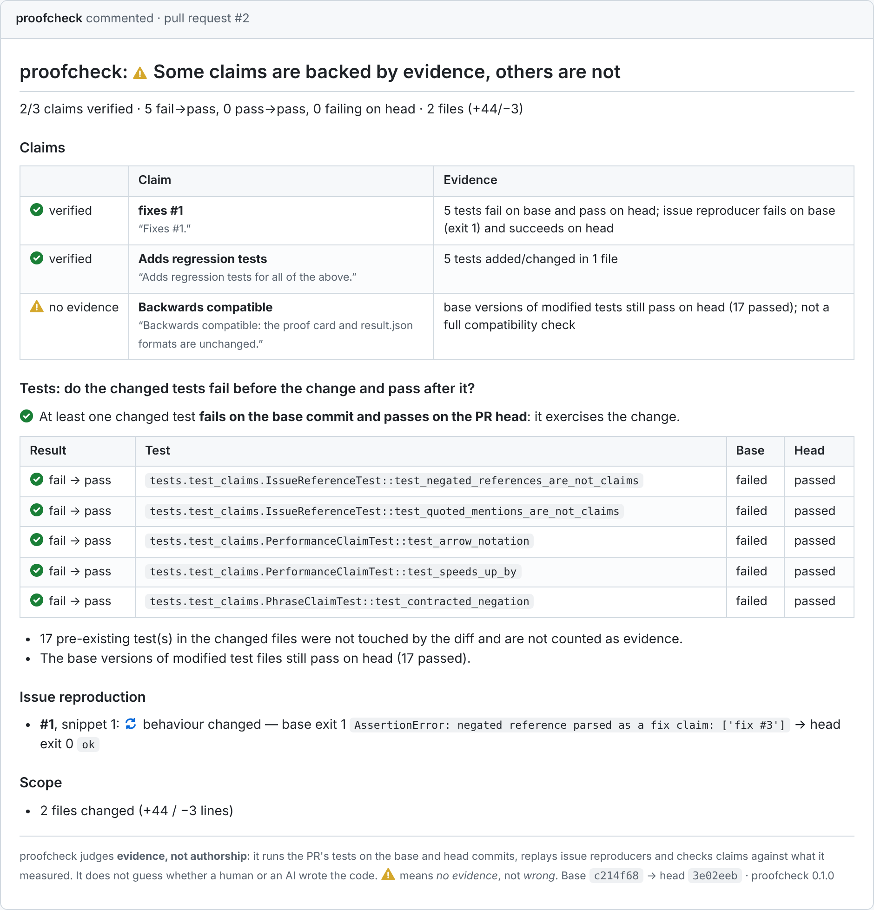

# proofcheck

**Evidence, not authorship.** proofcheck is a GitHub Action and CLI that checks whether a pull request does what it claims. It runs the PR's own tests before and after the change, replays the reproducer from the linked issue, and compares the PR description against what it measured.

It makes no attempt to guess whether a human or an AI wrote the code. It only looks at evidence.

<p align="center">
  
  <br><sub>The card proofcheck posted on one of its own pull requests. Running it there also caught a bug in proofcheck itself: quoted example phrases in the description were being counted as claims.</sub>
</p>

> **Status:** early (0.1.0). Python/pytest support is the most complete. A stdlib `unittest` runner is included, and Jest support is experimental. Feedback and runners for other ecosystems are welcome.

## What the proof card looks like

Below is the **real output** of the bundled demo ([`examples/demo`](examples/demo)). The demo bug is that `word_count("hello  world")` returns 3. Two PRs claim to fix it.

**PR A: a real fix.** Its description says *"Fixes #1 … Adds a regression test. This is backwards compatible."*

> <!-- proofcheck:card -->
> ## proofcheck: ⚠️ Some claims are backed by evidence, others are not
>
> 2/3 claims verified · 1 fail→pass, 0 pass→pass, 0 failing on head · 2 files (+6/−4)
>
> ### Claims
>
> | | Claim | Evidence |
> |---|---|---|
> | ✅ verified | **fixes #‍1**<br><sub>“Fixes #‍1.”</sub> | 1 test fails on base and passes on head; issue reproducer fails on base (exit 1) and succeeds on head |
> | ✅ verified | **Adds a regression test**<br><sub>“Adds a regression test.”</sub> | 1 test added/changed in 1 file |
> | ⚠️ no evidence | **backwards compatible**<br><sub>“This is backwards compatible.”</sub> | base versions of modified tests still pass on head (2 passed); not a full compatibility check |
>
> ### Tests: do the changed tests fail before the change and pass after it?
>
> ✅ At least one changed test **fails on the base commit and passes on the PR head**: it exercises the change.
>
> | Result | Test | Base | Head |
> |---|---|---|---|
> | ✅ fail → pass | `tests.test_textutils.WordCountTest::test_repeated_whitespace` | failed | passed |
>
> - 2 pre-existing test(s) in the changed files were not touched by the diff and are not counted as evidence.
> - The base versions of modified test files still pass on head (2 passed).
>
> ### Issue reproduction
>
> - **Issue (from file)**, snippet 1: 🔁 behaviour changed — base exit 1 `AssertionError: expected 2 words, got 3` → head exit 0 `ok`
>
> ### Scope
>
> - 2 files changed (+6 / −4 lines)
>
> ---
> <sub>proofcheck judges <b>evidence, not authorship</b>: it runs the PR's tests on the base and head commits, replays issue reproducers and checks claims against what it measured. It does not guess whether a human or an AI wrote the code. ⚠️ means <i>no evidence</i>, not <i>wrong</i>. Base <code>ed2ade4</code> → head <code>9299af6</code> · proofcheck 0.1.0</sub>

**PR B: a plausible-looking fake.** Its description says *"Fixes #1. Rewrote word_count for clarity and it is now 2x faster. Adds tests for the fix."* The code is reformatted but the bug is still there, and the new test also passes on the unfixed code.

> <!-- proofcheck:card -->
> ## proofcheck: ❌ Evidence contradicts the PR
>
> 1/3 claims verified, 1 contradicted · 0 fail→pass, 1 pass→pass, 0 failing on head · 2 files (+9/−2)
>
> ### Claims
>
> | | Claim | Evidence |
> |---|---|---|
> | ❌ contradicted | **fixes #‍1**<br><sub>“Fixes #‍1.”</sub> | the issue reproducer still fails on head exactly as on base (exit 1) |
> | ⚠️ no evidence | **2x faster**<br><sub>“Rewrote word\_count for clarity and it is now 2x faster.”</sub> | unverified: no benchmark evidence (configure benchmark\_command to measure it) |
> | ✅ verified | **Adds tests**<br><sub>“Adds tests for the fix.”</sub> | 1 test added/changed in 1 file |
>
> ### Tests: do the changed tests fail before the change and pass after it?
>
> ⚠️ The changed tests **pass on the base commit too**, so they do not demonstrate the change.
>
> | Result | Test | Base | Head |
> |---|---|---|---|
> | ⚠️ pass → pass | `tests.test_textutils.WordCountTest::test_three_words` | passed | passed |
>
> - 2 pre-existing test(s) in the changed files were not touched by the diff and are not counted as evidence.
>
> ### Issue reproduction
>
> - **Issue (from file)**, snippet 1: ⚠️ unchanged — base exit 1 `AssertionError: expected 2 words, got 3` → head exit 1 `AssertionError: expected 2 words, got 3`
>
> ### Scope
>
> - 2 files changed (+9 / −2 lines)
>
> ---
> <sub>proofcheck judges <b>evidence, not authorship</b>: it runs the PR's tests on the base and head commits, replays issue reproducers and checks claims against what it measured. It does not guess whether a human or an AI wrote the code. ⚠️ means <i>no evidence</i>, not <i>wrong</i>. Base <code>ed2ade4</code> → head <code>3404e5d</code> · proofcheck 0.1.0</sub>

On GitHub, these cards are posted (and updated in place) as a single PR comment.

## Why evidence instead of AI detection?

Maintainers increasingly get pull requests that *look* right: tidy code, a confident description, "Fixes #123", a new test. Some come from people and some from AI tools. Tools that try to classify a PR as AI-generated answer a question maintainers don't actually need answered, and they produce false positives that hurt real contributors.

proofcheck asks the questions a careful reviewer asks first:

- **Does the new test fail without the fix and pass with it?** A test that passes on the base commit too does not exercise the change, however plausible it looks. This is the "fail-to-pass" criterion used to validate fixes in benchmarks such as SWE-bench.
- **Does the issue's reproducer behave differently after the change?**
- **Do the description's claims hold up?** That covers "fixes #N", "adds tests", "3x faster", "no behaviour change" and "backwards compatible".
- **Does the diff touch anything surprising,** such as CI workflows, dependency manifests, binaries, or files unrelated to the description?

A good human PR and a good AI-assisted PR both pass. A sloppy PR from either source gets a card that shows exactly what is missing. ⚠️ means **no evidence**, not **wrong**.

## Quick start (GitHub Actions)

proofcheck uses **two workflows**. Running untrusted PR code and holding a token that can write comments must never happen in the same job ([why](#security-model)).

**1. `.github/workflows/proofcheck.yml`** gathers evidence. It is unprivileged and is the only place PR code runs.

```yaml
# proofcheck, part 1 of 2: gather evidence (UNPRIVILEGED).
#
# Runs on `pull_request`, so for fork PRs GitHub gives this workflow a
# read-only token and no repository secrets. Untrusted PR code (tests, issue
# reproducers, benchmarks) only ever runs here. The result is uploaded as an
# artifact; part 2 (proofcheck-comment.yml) posts it.
#
# Pin bhaskargurram-ai/proofcheck to a release tag, or (stricter) to a full commit SHA
# (ideally a full commit SHA).
name: proofcheck

on:
  pull_request:
    types: [opened, synchronize, reopened, edited]

permissions:
  contents: read
  issues: read   # lets the `context` step read linked issues on private repos (read-only)

concurrency:
  group: proofcheck-${{ github.event.pull_request.number }}
  cancel-in-progress: true

jobs:
  evidence:
    runs-on: ubuntu-latest
    timeout-minutes: 30
    steps:
      - uses: actions/checkout@v4
        with:
          ref: ${{ github.event.pull_request.head.sha }}
          fetch-depth: 0              # proofcheck needs the base commit too
          persist-credentials: false  # do not leave a token in .git/config for PR code to find

      - uses: actions/setup-python@v5
        with:
          python-version: "3.12"

      # Collect the PR text and referenced issue bodies BEFORE any PR code
      # runs. This is the only step that receives a token (read-only here).
      - uses: bhaskargurram-ai/proofcheck@v0.1.0  # or pin to a commit SHA for stricter supply-chain safety
        with:
          command: context
          github-token: ${{ github.token }}

      # Install the project under test the way your CI normally does.
      # NOTE: this executes PR-controlled code (setup.py, build hooks).
      - name: Install project and test dependencies
        run: |
          python -m pip install -e . pytest

      - id: proofcheck
        uses: bhaskargurram-ai/proofcheck@v0.1.0  # or pin to a commit SHA for stricter supply-chain safety
        with:
          command: run
          fail-on: never   # or "contradicted" to fail the check

      - uses: actions/upload-artifact@v4
        if: always()
        with:
          name: proofcheck-result
          path: |
            proofcheck-out/result.json
            proofcheck-out/card.md
            proofcheck-out/pr_number
          if-no-files-found: ignore
          retention-days: 7
```

**2. `.github/workflows/proofcheck-comment.yml`** posts the card. It is privileged and never runs PR code.

```yaml
# proofcheck, part 2 of 2: post the proof card (PRIVILEGED, never runs PR code).
#
# Triggered when part 1 completes. `workflow_run` runs in the context of the
# base repository with a token that can write PR comments, so this workflow
# must NEVER check out, install, build or execute anything from the pull
# request. It only:
#   1. downloads the artifact produced by part 1,
#   2. validates the PR number and the result.json schema,
#   3. checks the result belongs to the PR's current head commit,
#   4. re-renders the card from the validated data and upserts the comment.
#
# Why not `pull_request_target`? It also runs with a write token and secrets,
# and checking out `github.event.pull_request.head.sha` there runs attacker
# code with those privileges ("pwn request"). See docs/SECURITY_MODEL.md.
name: proofcheck comment

on:
  workflow_run:
    workflows: ["proofcheck"]   # must match the `name:` of part 1
    types: [completed]

permissions:
  contents: read        # check out this repo's own (trusted) default branch; required on private repos
  pull-requests: write
  actions: read

jobs:
  comment:
    if: github.event.workflow_run.event == 'pull_request' && github.event.workflow_run.conclusion != 'cancelled'
    runs-on: ubuntu-latest
    timeout-minutes: 5
    steps:
      - uses: actions/setup-python@v5
        with:
          python-version: "3.12"

      - name: Download result artifact
        uses: actions/download-artifact@v4
        with:
          name: proofcheck-result
          path: ${{ runner.temp }}/proofcheck-artifact
          run-id: ${{ github.event.workflow_run.id }}
          github-token: ${{ github.token }}

      - name: Validate PR number
        id: pr
        env:
          ARTIFACT_DIR: ${{ runner.temp }}/proofcheck-artifact
        run: |
          set -euo pipefail
          pr="$(head -c 20 "$ARTIFACT_DIR/pr_number" | tr -d '[:space:]')"
          if ! [[ "$pr" =~ ^[0-9]{1,10}$ ]]; then
            echo "::error::artifact contains an invalid PR number"; exit 1
          fi
          echo "number=$pr" >> "$GITHUB_OUTPUT"

      # The action installs proofcheck from its own (trusted) source, never from the PR.
      - uses: bhaskargurram-ai/proofcheck@v0.1.0  # or pin to a commit SHA for stricter supply-chain safety
        with:
          command: comment
          result: ${{ runner.temp }}/proofcheck-artifact/result.json
          pr-number: ${{ steps.pr.outputs.number }}
          expected-head-sha: ${{ github.event.workflow_run.head_sha }}
          github-token: ${{ github.token }}
```

Adjust the "Install project and test dependencies" step to match how your CI installs things. Pin the action to a full commit SHA if you want to be strict.

## Checks in detail

### 1. Fail-to-pass tests (the headline check)

1. proofcheck finds test files added or modified between the merge base and the PR head. For pytest these are `test_*.py`, `*_test.py`, `conftest.py` and anything under `tests/` or `test/`. The patterns are configurable.
2. It creates a temporary **git worktree of the base commit** and copies **only the changed test files** from the head into it. It also creates a worktree of the head commit.
3. It runs the changed test modules in both worktrees and reads per-test outcomes from JUnit XML (`pytest --junitxml`).
4. It classifies every test that the diff **touched**, using the AST to find which test functions changed:

| Classification | Base | Head | Meaning |
|---|---|---|---|
| ✅ `fail_to_pass` | fail/error | pass | The test exercises the change. This is strong evidence. |
| ⚠️ `pass_to_pass` | pass | pass | The test does not exercise the change. |
| ❌ `fail_on_head` | any | fail/error | The PR's own tests fail. |
| ❔ `error` / ⏭️ `skipped` | | | No usable outcome. |

A new test module that cannot even be imported on base (because the code it tests doesn't exist yet) counts as fail-to-pass for its tests. Pre-existing tests in a modified file that the diff did not touch are reported but **not counted**. If the PR changes no tests, the card says so: *"⚠️ No test evidence"*.

When the PR claims *no behaviour change* or *backwards compatibility*, proofcheck also runs the **base versions of modified test files against the head code** to check whether the old expectations still hold.

### 2. Claim extraction

A deterministic, rule-based extractor (always on) looks for these claims in the PR title and description. It ignores code blocks, inline code, quotes and HTML comments, such as unfilled PR templates.

| Claim type | Examples |
|---|---|
| `fixes_issue` | `Fixes #123`, `closes #4, #5`, `resolves owner/repo#9`, issue URLs |
| `performance` | `3x faster`, `2.5× speedup`, `40% faster`, `from 162 s to 0.22 s`, `reduces memory by 30%` |
| `no_behavior_change` | `no functional change`, `refactor only`, `does not change behavior` |
| `adds_tests` | `adds tests`, `added a regression test`, `includes unit tests` |
| `backwards_compatible` | `backwards compatible`, `no breaking changes` |

An **optional LLM extractor** can add claims that the rules missed. It is off by default, and it can add claims to check but can never mark anything as verified. See [LLM extraction](#optional-llm-claim-extraction).

### 3. Claim → evidence rules

| Claim | ✅ verified when | ❌ contradicted when |
|---|---|---|
| fixes #N | ≥ 1 fail-to-pass test, **or** the issue's reproducer fails on base and succeeds on head | changed tests fail on head, **or** the issue's reproducer fails identically on base and head |
| adds tests | test functions were added or changed and ran | the diff changes no test files |
| no behaviour change | never; absence of change cannot be proven | fail-to-pass tests exist, a reproducer's behaviour changed, or base versions of modified tests fail on head |
| backwards compatible | never; it is only reported as "not contradicted" | base versions of modified tests fail on head |
| performance (time) | with `benchmark_command`, the measured speedup is ≥ 50 % of the claimed improvement (claimed 3x needs ≥ 2x) | the head is measurably slower |
| performance (memory) | not measured yet, so it is always ⚠️ | |

Everything else is ⚠️ *no evidence*.

### 4. Issue reproduction

For every `fixes #N` that points at the same repository, the `context` step fetches the issue body. Locally, you can pass `--issue-body-file`. proofcheck extracts fenced `python` code blocks (skipping `>>>` sessions and tracebacks) and runs each one on base and on head:

- in a subprocess with a timeout, with the worktree on `PYTHONPATH`, from a throwaway directory;
- with an environment that has secret-looking variables removed (`*TOKEN*`, `*SECRET*`, `*KEY*`, `*PASSWORD*`, …);
- comparing exit code, stdout and stderr, with worktree paths and memory addresses normalised.

Each snippet is reported as `behavior_changed`, `unchanged` or `error`.

### 5. Scope check

- ⚠️ changes to `.github/workflows/`, `action.yml` and other CI config
- ⚠️ dependency manifests and lockfiles (`requirements*.txt`, `pyproject.toml`, `setup.py`, `package.json`, `*.lock`, …)
- ⚠️ binary files
- ⚠️ diffs larger than `large_diff_threshold` changed lines
- 🔎 *heuristic:* non-test files whose path shares no word with the PR title or description, flagged only when the description does mention other changed files. It is clearly labelled as a heuristic.

### 6. Output

- `card.md`: the Markdown proof card. It starts with the hidden marker `<!-- proofcheck:card -->` so that the comment is updated in place.
- `result.json`: the full machine-readable result (schema `proofcheck/result`, version 1).

## CLI

```bash
pip install .            # or: pip install -e ".[dev]" for development

# Gather evidence for a branch against main
proofcheck run --repo . --base origin/main --head HEAD \
    --pr-body-file pr.md --issue-body-file issue.md \
    --out card.md --json result.json

# Post or update the PR comment (GITHUB_TOKEN, GITHUB_REPOSITORY)
proofcheck comment --json result.json --pr 123

# CI helper: collect PR text + referenced issues before any PR code runs
proofcheck context --out context.json
```

Useful `run` options:

| Option | Purpose |
|---|---|
| `--runner pytest\|unittest\|jest` | choose the test runner (default from config, else `pytest`) |
| `--test-command "…"` | override the test command (split like a shell, never run through one) |
| `--config FILE` | config file; by default config is read **from the base commit** |
| `--context-file FILE` | PR title, body and issues from `proofcheck context` |
| `--pr-body-file FILE` | PR description; a first line `Title: …` or `# …` is used as the title |
| `--issue-body-file FILE` | issue text to reproduce (repeatable) |
| `--fail-on never\|contradicted\|no-evidence` | exit 1 for that verdict or worse |
| `--llm/--no-llm` | enable the optional LLM extractor |
| `--skip-tests` | skip the fail-to-pass run |

`comment` options: `--pr`, `--repo`, `--expect-head-sha` (refuse unless the PR head matches), `--bot-login`, `--no-check-pr-files`, `--dry-run`.

You can also run `python -m proofcheck …`.

### Try the demo

```bash
examples/demo/run_demo.sh /tmp/proofcheck-demo
```

The script builds a small repository with a `fix-real` branch and a `fix-fake` branch and runs proofcheck on both. It uses pytest when pytest is installed and otherwise falls back to the stdlib `unittest` runner. The cards above came from the `unittest` runner. Set `PROOFCHECK_RUNNER=pytest` to force pytest.

## Configuration

Put a `proofcheck.toml` at the repository root, or a `[tool.proofcheck]` table in `pyproject.toml`. **The file is read from the PR's base commit**, so a PR cannot change how it is checked.

```toml
runner = "pytest"                      # pytest | unittest | jest
test_command = "python -m pytest -x"   # optional; {junitxml} and {tests} placeholders supported
test_patterns = ["tests/*", "test_*.py", "*_test.py", "conftest.py"]   # files copied from head into base
test_module_patterns = ["test_*.py", "*_test.py"]                     # files that are run
timeout = 600                          # seconds per test run
setup_command = ""                     # optional, run in each worktree before tests (e.g. a build step)
large_diff_threshold = 1000            # changed lines
max_issues = 5

# Optional benchmark for performance claims: runs N times on base and head
# (interleaved) and compares median wall time.
benchmark_command = ["python", "benchmarks/bench_parse.py"]
benchmark_runs = 5
benchmark_timeout = 600

[test_env]                             # extra env vars for test runs
APP_ENV = "test"

[repro]
enabled = true
timeout = 60
python = "python"                      # interpreter for issue snippets

[llm]
enabled = false                        # see below; the API key is never read from this file
provider = "openai"                    # or "anthropic"
model = ""
base_url = ""
```

By default, tests and reproducers run with `$PROOFCHECK_PYTHON`, or else the `python` on `PATH`, so they see your project's installed dependencies. The action's `python` input sets this variable.

### Optional LLM claim extraction

Set `PROOFCHECK_LLM_PROVIDER` (`openai` for any OpenAI-compatible chat endpoint, or `anthropic` for the Messages API), `PROOFCHECK_LLM_API_KEY` and `PROOFCHECK_LLM_MODEL`, plus `PROOFCHECK_LLM_BASE_URL` if needed. Then pass `--llm` or set `llm.enabled = true`.

The PR text is sent as untrusted data inside random delimiters, the model gets no tools, and only strict JSON is accepted. Every claim must quote text that actually appears in the PR. LLM-found claims are marked as such on the card, and they can only add things to check. Given the [security model](docs/SECURITY_MODEL.md), don't put an API key into the unprivileged workflow that runs PR code unless you accept that risk.

## Security model

Running PR code safely is the core problem. Summary:

- **Untrusted code runs only in the `pull_request` workflow**, with `contents: read`, no secrets, `persist-credentials: false`, a scrubbed environment, timeouts, and config read from the base commit.
- **The comment is posted by a `workflow_run` workflow that never checks out or executes PR code.** It validates the PR number and the `result.json` schema, re-renders the card itself (the uploaded `card.md` is ignored), checks that the result matches the PR's current head SHA, and warns on the card when the PR modifies workflows or test-harness files.
- **Never use `pull_request_target` together with a checkout of the PR head.** That combination runs attacker code with a write token and your secrets.
- **All PR-derived text is escaped** in the card. That covers HTML, @mentions, issue references, links, table pipes and control characters.
- **Prompt injection:** the rule-based path has nothing to inject into. The optional LLM path treats text as data, and its output can't produce verdicts.

proofcheck raises the bar for low-effort PRs. It is **not** a sandbox and not a defence against a determined attacker. Read [docs/SECURITY_MODEL.md](docs/SECURITY_MODEL.md) for the threat model.

## Limitations

- A "fail-to-pass" test proves the PR changes behaviour that the test checks. It does not prove the test checks the *right* behaviour. Review is still required.
- Test runs share the CI job with PR code, so a malicious PR can tamper with its own results. The comment workflow detects changes to the harness, but not every kind of manipulation.
- Benchmarks on shared CI runners are noisy. Differences under 5 % are treated as noise.
- Only Python snippets are reproduced from issues, and they are only compared against the previous behaviour, not against an expected output.
- The Jest runner is experimental. It needs `jest-junit` installed in the project and has not been tested against many real projects yet.

## Roadmap

- Runners for **Vitest**, **Go** (`go test` + `go-junit-report`), **Rust** (`cargo test`/nextest JUnit) and a hardened Jest runner
- Benchmark integrations (pytest-benchmark, hyperfine, criterion) and memory measurements
- Reproducers in other languages and expected-output assertions from issues
- A GitHub App mode that runs checks in isolated sandboxes instead of the PR's CI job
- Check-run annotations next to the PR comment

## Contributing

Contributions are welcome. See [CONTRIBUTING.md](CONTRIBUTING.md). In short:

```bash
pip install -e ".[dev]"
python -m pytest            # or, without pytest: python -m unittest discover -s tests
```

The test suite builds real throwaway git repositories and worktrees, so it needs `git` on `PATH`.

## License

[MIT](LICENSE) © 2026 Bhaskar Gurram
